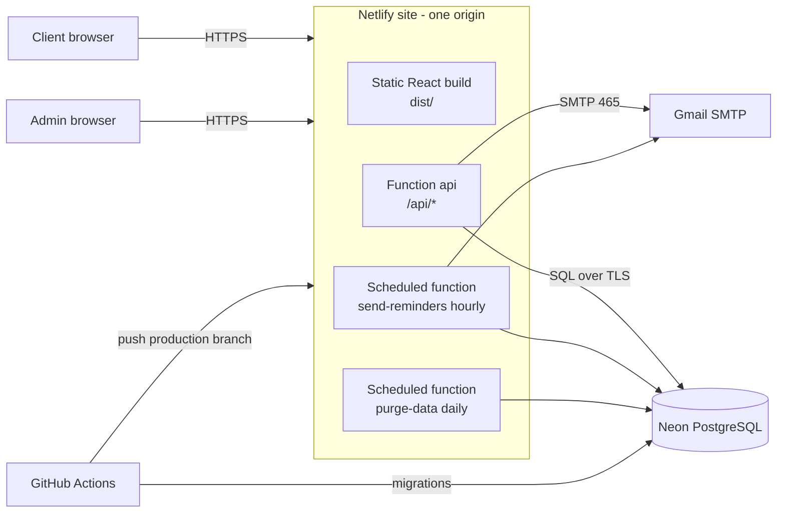

# ARCHITECTURE — System design and technology decisions

**Status:** v1.0, approved 2026-11-25, implemented. Tags: **[C]** confirmed by you, **[R]** recommendation.
Free-tier facts were checked on 2026-11-25 against the providers' documentation. They change; re-check before relying on them.

**Changes from v0.2:** FastAPI on Render replaced by **Netlify Functions (TypeScript)**; Resend replaced by **Nodemailer + Gmail SMTP**; reminders and purge run as **Netlify scheduled functions** instead of GitHub cron; one admin configured by environment variables instead of an `admin_users` table; scrypt instead of Argon2id (no native module to bundle).

---

## 1. Technology stack

### 1.1 Decisions

| Layer          | Choice                                                                                                                                                                                                 | Why                                                                                                                                                                                         | Tag            |
| -------------- | ------------------------------------------------------------------------------------------------------------------------------------------------------------------------------------------------------ | ------------------------------------------------------------------------------------------------------------------------------------------------------------------------------------------- | -------------- |
| Frontend       | **React 18 + TypeScript + Vite**, React Router, `react-day-picker` (accessible calendar, French locale), one global stylesheet with the demo's design tokens, self-hosted fonts (Young Serif, Figtree) | Mainstream and testable. Self-hosting the fonts keeps the Content-Security-Policy at `'self'`.                                                                                              | [R]            |
| API            | **Netlify Functions v2** (Node 22, TypeScript), one function `api` mounted on `/api/*` with a small in-house router                                                                                    | Same origin as the site: no CORS, first-party cookie. No server that sleeps.                                                                                                                | [C] Netlify    |
| Validation     | **Zod 4** (`.strict()` schemas)                                                                                                                                                                        | Rejects unknown fields (mass assignment), length limits, formats.                                                                                                                           | [R]            |
| Dates          | **Luxon**, zone `Europe/Paris`                                                                                                                                                                         | Correct wall-clock ↔ UTC conversion on DST days.                                                                                                                                            | [R]            |
| Database       | **Neon PostgreSQL** (Free), driver `pg`, plain SQL migrations (`db/migrations/*.sql`) applied by `scripts/migrate.ts`                                                                                  | The **exclusion constraint** makes double booking impossible; plain SQL keeps it explicit. Neon is used directly rather than Netlify Database, which is paid from the same Netlify credits. | [R]            |
| Email          | **Nodemailer** over **Gmail SMTP** (port 465, app password; the Google account needs 2-Step Verification) behind a `Mailer` interface (`SmtpMailer`, `LogMailer`, `MemoryMailer`)                      | No domain to buy; ~500 messages/day on a personal Gmail account is far above demo needs; provider stays swappable.                                                                          | [C] Nodemailer |
| Admin auth     | One admin: `ADMIN_EMAIL` + `ADMIN_PASSWORD_HASH` (scrypt) in environment variables; sessions stored hashed in `admin_sessions`; cookie `__Host-sillage_admin`, `HttpOnly; Secure; SameSite=Lax`, 12 h  | Simple, revocable (logout deletes the row), nothing to seed.                                                                                                                                | [R]            |
| Client "auth"  | Random 256-bit token per booking, emailed; only its SHA-256 is stored                                                                                                                                  | Guest booking, no account.                                                                                                                                                                  | [C]            |
| Scheduled jobs | Netlify scheduled functions: `send-reminders` (hourly), `purge-data` (daily 02:17 UTC)                                                                                                                 | Available on the free plan; no external cron. They run only on published production deploys.                                                                                                | [R]            |
| Map            | Inline schematic SVG + link to OpenStreetMap                                                                                                                                                           | No tiles, no key, CSP stays strict.                                                                                                                                                         | [R]            |
| CI             | **GitHub Actions** (lint, types, audit, gitleaks, tests on PostgreSQL 16, Playwright + axe)                                                                                                            | Matches the DevOps lab.                                                                                                                                                                     | [C]            |
| Hosting        | **Netlify Free** (300 credits/month; a production deploy costs 15 credits; preview and branch deploys are free)                                                                                        | Same site serves pages and API.                                                                                                                                                             | [C]            |

### 1.2 Alternatives considered

| Alternative                   | Verdict                                                                                       |
| ----------------------------- | --------------------------------------------------------------------------------------------- |
| FastAPI on Render (v0.2 plan) | Dropped: free service sleeps ~1 min; you chose Netlify + Nodemailer.                          |
| Next.js on Netlify            | Valid, but more framework than this MVP needs today.                                          |
| Supabase                      | Hides the backend a course expects you to build.                                              |
| Netlify Database              | Consumes Netlify credits; Neon Free is separate and free.                                     |
| Resend / Brevo                | Need a verified domain for real recipients (Resend) or another account; Gmail SMTP works now. |
| Argon2id                      | Native module complicates function bundling; scrypt is built into Node and memory-hard.       |

### 1.3 Free-tier constraints

| Fact                                                                                                                                              | Consequence                                                                                                                                             |
| ------------------------------------------------------------------------------------------------------------------------------------------------- | ------------------------------------------------------------------------------------------------------------------------------------------------------- |
| Netlify Free: 300 credits/month; production deploy = 15 credits; previews and branch deploys free; going over suspends the site until next month. | Production is published **only on a release tag** (≈ 20 production deploys/month max). Day-to-day work uses free previews and the `main` branch deploy. |
| Neon Free: 1 GB and 100 CU-hours per project per month, scale-to-zero after 5 min, 6-hour instant restore, no scheduled backups.                  | Two projects (staging, production) at 0.25 CU. Backups are a backlog item (`ROADMAP.md`).                                                               |
| Gmail SMTP: app password required (2-Step Verification); ~500 messages/day for a personal account; sender is a Gmail address.                     | Fine for a demo. `MAIL_MODE=log` disables sending entirely.                                                                                             |

## 2. High-level architecture



## 3. Components

| Component    | Path                             | Responsibility                                                                    |
| ------------ | -------------------------------- | --------------------------------------------------------------------------------- |
| Pages        | `src/web/pages`                  | Home (services, team, gallery, info, contact), booking, manage, legal, admin      |
| API client   | `src/web/api.ts`                 | Same-origin `fetch`, error mapping                                                |
| Router       | `src/server/http/router.ts`      | Routes, Origin check, admin guard, error shape, request id, request log           |
| Domain rules | `src/server/domain`              | Pure functions: slot computation, start checks, cancellation rule, stylist choice |
| Services     | `src/server/services`            | Catalogue, availability, bookings, admin, auth, rate limit, jobs                  |
| Email        | `src/server/email`               | `Mailer` implementations and French templates (HTML escaped)                      |
| Database     | `src/server/db`, `db/migrations` | Pool, transactions, migrations, seed                                              |
| Functions    | `netlify/functions`              | `api.mts`, `send-reminders.mts`, `purge-data.mts`                                 |
| Scripts      | `scripts/`                       | `migrate`, `seed`, `hash-password`, `local-server` (for E2E without Netlify CLI)  |

**Communication:** browser ↔ API JSON over HTTPS under `/api`; API ↔ Neon via `pg` over TLS (pool of 3 per function instance); API ↔ Gmail via SMTP over TLS. Dependencies are injected (`Deps`: pool, mailer, config, clock) so the router is tested end-to-end without Netlify.

## 4. Data flow: booking a slot

```mermaid
sequenceDiagram
  participant B as Browser
  participant F as Function api
  participant DB as PostgreSQL
  participant M as Gmail SMTP
  B->>F: GET /api/availability?serviceId&stylistId&from&to
  F->>DB: hours, time off, closures, confirmed bookings
  F-->>B: days with free slots (advisory)
  B->>F: POST /api/bookings
  F->>F: validate (Zod), grid + lead + horizon, rate limit, recompute slot
  F->>DB: BEGIN; advisory lock on email; BR-07 count
  loop each eligible stylist (fewest bookings first)
    F->>DB: SAVEPOINT; INSERT booking
    alt exclusion constraint violated
      DB-->>F: 23P01 -> ROLLBACK TO SAVEPOINT, try next
    else inserted
      DB-->>F: id
    end
  end
  F->>DB: COMMIT
  F->>M: confirmation email (failure logged, booking kept)
  F-->>B: 201 summary + manageUrl, or 409 slot_taken
```

**Key rule:** availability is advisory; the **database constraint is authoritative**.

### 4.1 Availability algorithm

For each requested local day and each eligible stylist: build each working-hours window in Europe/Paris for that date, align to the 15-minute grid, and offer a start when the whole service fits in the window, does not overlap time off, closures or confirmed bookings, and lies between now + 2 h and now + 90 days. Results are merged per start time with the list of free stylists. Range capped at 42 days.

## 5. Database schema (`db/migrations/001_initial.sql`)

| Table               | Key columns                                                                                                                                                                                                                                         | Notes                                                                                                              |
| ------------------- | --------------------------------------------------------------------------------------------------------------------------------------------------------------------------------------------------------------------------------------------------- | ------------------------------------------------------------------------------------------------------------------ |
| `services`          | `id`, `slug` unique, `name`, `description`, `category` (women/men/children), `duration_min`, `price_cents`, `is_active`, `sort_order`                                                                                                               | Integer cents                                                                                                      |
| `stylists`          | `id`, `slug`, `display_name`, `specialty`, `bio`, `is_active`, `sort_order`                                                                                                                                                                         |                                                                                                                    |
| `stylist_services`  | PK (`stylist_id`, `service_id`)                                                                                                                                                                                                                     | Who does what                                                                                                      |
| `working_hours`     | `stylist_id`, `weekday` 1–7, `start_time`, `end_time`                                                                                                                                                                                               | Local time; several rows per day (lunch break)                                                                     |
| `time_off`          | `stylist_id`, `starts_at`, `ends_at`, `reason`                                                                                                                                                                                                      | timestamptz                                                                                                        |
| `closures`          | `starts_at`, `ends_at`, `reason`                                                                                                                                                                                                                    | Whole salon                                                                                                        |
| `bookings`          | `service_id`, `stylist_id`, `starts_at`, `ends_at`, `status`, customer fields, snapshots (`service_name`, `price_cents`, `duration_min`), `manage_token_hash` unique, `privacy_notice_version`, `reminder_sent_at`, `cancelled_at`, `anonymised_at` | `EXCLUDE USING gist (stylist_id WITH =, tstzrange(starts_at, ends_at, '[)') WITH &&) WHERE (status = 'confirmed')` |
| `admin_sessions`    | `id_hash` PK, `expires_at`                                                                                                                                                                                                                          | Cookie holds the id; DB holds its hash                                                                             |
| `rate_limit_events` | `key`, `created_at`                                                                                                                                                                                                                                 | Sliding-window limits (serverless has no shared memory)                                                            |
| `contact_messages`  | `name`, `email`, `message`, `created_at`                                                                                                                                                                                                            | Deleted after 90 days                                                                                              |
| `email_log`         | `booking_id`, `kind`, `status`, `error`                                                                                                                                                                                                             | Troubleshooting                                                                                                    |
| `schema_migrations` | `name`                                                                                                                                                                                                                                              | Applied migration files                                                                                            |

## 6. API (base `/api`, JSON, ISO 8601 with offset)

Error shape: `{ "error": { "code": "slot_taken", "message": "…", "details": {} } }`.

| Method + path                                            | Auth                                         | Result                                                                                                                   |
| -------------------------------------------------------- | -------------------------------------------- | ------------------------------------------------------------------------------------------------------------------------ |
| `GET /services`, `GET /stylists`                         | public                                       | 200, cached 5 min                                                                                                        |
| `GET /availability?serviceId&stylistId?&from&to`         | public                                       | 200 `{timezone, durationMin, days:[{date, slots:[{start, stylistIds}]}]}`; 422                                           |
| `POST /bookings`                                         | public, 5/h/IP                               | 201 `{id, status, startsAt, endsAt, service, stylist, manageUrl}`; 409 `slot_taken` / `too_many_bookings`; 422; 415; 429 |
| `GET /manage/booking`                                    | header `X-Manage-Token`                      | 200; 404                                                                                                                 |
| `POST /manage/booking/cancel`                            | header `X-Manage-Token`                      | 200; 403 `too_late_to_cancel`; 409; 404                                                                                  |
| `POST /contact`                                          | public, 5/h/IP                               | 202; 422; 429                                                                                                            |
| `GET /healthz`, `GET /readyz`                            | public                                       | 200 (readyz checks the DB)                                                                                               |
| `POST /admin/session`                                    | — (5 failures / 15 min / IP and email → 429) | 200 + cookie; 401                                                                                                        |
| `DELETE /admin/session`, `GET /admin/me`                 | admin                                        | 200                                                                                                                      |
| `GET /admin/bookings?from&to`                            | admin                                        | 200 (≤ 62 days)                                                                                                          |
| `POST /admin/bookings/:id/cancel`                        | admin                                        | 200 (client emailed)                                                                                                     |
| `GET /admin/stylists`                                    | admin                                        | 200                                                                                                                      |
| `GET/POST /admin/time-off`, `DELETE /admin/time-off/:id` | admin                                        | Days off (local datetimes `YYYY-MM-DDTHH:mm`)                                                                            |
| `GET/POST /admin/closures`, `DELETE /admin/closures/:id` | admin                                        | Salon closures                                                                                                           |

## 7. Scalability and performance

Assumed load: 3 stylists, ~100 bookings/week, ~5,000 visits/month. Functions scale automatically; the database is the only shared state. Availability uses 4 queries per request and is computed in memory. Indexes: exclusion constraint (gist on stylist + range), `bookings(starts_at)`, `lower(customer_email)`. Static assets are hashed and cached for a year. Growth path: paid Netlify plan for more deploys, Neon autoscaling.

## 8. Security

### 8.1 Authentication and access control

- Every admin route is registered with `admin: true` and passes through `requireAdmin` before its handler. A test reads the route table and checks that each one returns 401 with no cookie and with a forged cookie.
- Passwords: scrypt (N = 2^15, r = 8, p = 1), minimum 12 characters, constant-time comparison. The password is checked even when the email is wrong, so timing does not reveal which was wrong. Generic error message.
- Login rate limit: 5 failures per 15 minutes per IP **and** per email; the 6th attempt returns 429.
- Session cookie: `__Host-` prefix, `HttpOnly`, `Secure`, `SameSite=Lax`, 12 h, stored hashed server-side; logout deletes it.
- **CSRF:** SameSite=Lax + JSON-only bodies (other content types → 415) + `Origin` must equal `APP_BASE_URL` on state-changing requests.
- Private booking link: 32 random bytes (base64url), SHA-256 stored, sent in the URL **fragment** (`/gerer#t=…`) so it never reaches server logs or `Referer`; the page removes it from the address bar and sends it in `X-Manage-Token`. Unknown token → 404 (no existence oracle).

### 8.2 Input validation

Zod strict schemas on every body and query; email, phone, length limits; `start` must be on the 15-minute grid; honeypot field `website` must be empty; bodies over 10 kB rejected; all SQL uses bound parameters.

### 8.3 Secrets and environment variables

`DATABASE_URL`, `APP_BASE_URL`, `APP_ENV`, `ADMIN_EMAIL`, `ADMIN_PASSWORD_HASH`, `MAIL_MODE`, `SMTP_HOST`, `SMTP_PORT`, `SMTP_USER`, `SMTP_PASS`, `MAIL_FROM`, `SALON_INBOX`. Stored in Netlify environment variables (per deploy context: production vs. deploy previews/branch deploys) and GitHub Environment secrets (`STAGING_DATABASE_URL`, `PROD_DATABASE_URL`). `.env` is git-ignored; `.env.example` documents them. gitleaks runs in CI.

### 8.4 Data protection

TLS everywhere; encryption at rest by Neon. Logs are JSON with no personal data (emails masked, no bodies, no tokens). Security headers in `netlify.toml`: CSP `default-src 'self'` (no third-party scripts, fonts or tiles), HSTS, `nosniff`, `Referrer-Policy: no-referrer`, `frame-ancestors 'none'`, Permissions-Policy. Retention in `PRD.md` section 7.

### 8.5 Risks and mitigations

| Risk                              | Mitigation                                                                                                                                    |
| --------------------------------- | --------------------------------------------------------------------------------------------------------------------------------------------- |
| Double booking                    | Exclusion constraint + savepoint retry + concurrency test                                                                                     |
| BR-07 bypass by parallel requests | Transaction-level advisory lock per email                                                                                                     |
| Spam bookings                     | 5/h/IP, BR-07, honeypot, admin cancel                                                                                                         |
| SQL injection                     | Bound parameters only                                                                                                                         |
| XSS                               | React escaping, escaped email templates, strict CSP                                                                                           |
| CSRF                              | SameSite, JSON-only, Origin check                                                                                                             |
| Brute force                       | Rate limit, scrypt, generic errors                                                                                                            |
| IDOR / guessable links            | 256-bit tokens hashed at rest, UUIDs, 404 on unknown                                                                                          |
| Contact form as spam relay        | Fixed recipient (salon), rate limit, length limits                                                                                            |
| Vulnerable dependencies           | `npm audit` gate in CI, Dependabot. On 2026-11-25 the gate caught Nodemailer 6, Zod 3 and React Router 6 advisories; all three were upgraded. |
| Secret leakage                    | gitleaks, `.env` ignored, no secrets in logs                                                                                                  |
| Clickjacking                      | `frame-ancestors 'none'`                                                                                                                      |

### 8.6 Security testing

See `TESTING.md` section 6.

## 9. Project directory structure

```text
studio-sillage/
├── netlify/functions/        api.mts, send-reminders.mts, purge-data.mts
├── src/
│   ├── server/
│   │   ├── config.ts  deps.ts  runtime.ts  log.ts  security.ts
│   │   ├── domain/           rules.ts, availability.ts, booking.ts   (pure)
│   │   ├── services/         catalog, availability, bookings, admin, auth, rateLimit, jobs
│   │   ├── http/             router.ts, http.ts
│   │   ├── email/            mailer.ts, templates.ts
│   │   └── db/               pool.ts, migrate.ts, seed.ts
│   └── web/
│       ├── main.tsx  api.ts  format.ts
│       ├── components/       Layout.tsx, Illustration.tsx
│       ├── pages/            Home, Book, Manage, Legal, admin/Admin
│       └── styles/global.css
├── db/migrations/            001_initial.sql
├── scripts/                  migrate.ts, seed.ts, hash-password.ts, local-server.ts
├── tests/unit/  tests/integration/
├── e2e/                      booking.spec.ts, site.spec.ts
├── .github/workflows/        ci.yml, staging.yml, release.yml
├── docs/                     PRD, ARCHITECTURE, TESTING, DEVOPS, ROADMAP
├── netlify.toml  package.json  tsconfig.json  vite.config.ts  vitest.config.ts  playwright.config.ts
└── .env.example  README.md
```
