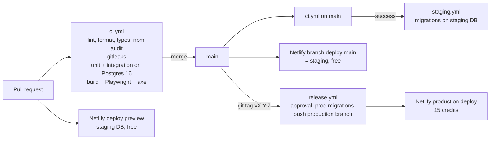

# DEVOPS — Infrastructure and CI/CD strategy

**Status:** v1.0, 2026-11-25. Tags: **[C]** confirmed, **[R]** recommendation.

**Changes from v0.1:** Render + GHCR replaced by Netlify's Git integration; reminders and purge moved to Netlify scheduled functions; production deploys budgeted against Netlify credits.

## 1. Git branching strategy [R]

| Element       | Rule                                                                                                                                                                                                                                            |
| ------------- | ----------------------------------------------------------------------------------------------------------------------------------------------------------------------------------------------------------------------------------------------- |
| `main`        | Always deployable. Protected: PR required, required checks green (`Lint, format, types, audit`, `Secret scan`, `Unit + integration tests`, `Build + end-to-end`), linear history. Netlify publishes it as a **branch deploy = staging** (free). |
| Work branches | `feat/…`, `fix/…`, `docs/…`, `chore/…`, one issue each, merged within days. Each PR gets a free Netlify **deploy preview**.                                                                                                                     |
| Merge         | Squash merge; PR title in Conventional Commits (`feat(booking): …`).                                                                                                                                                                            |
| Reviews       | Solo project [C]: GitHub does not allow approving your own PR, so the rule is "PR + green checks + self-review checklist" (`.github/pull_request_template.md`).                                                                                 |
| `production`  | **Only written by `release.yml`.** Netlify's production branch. Never pushed by hand.                                                                                                                                                           |
| Releases      | Tags `vX.Y.Z` on `main`.                                                                                                                                                                                                                        |

## 2. CI/CD pipeline



| Workflow      | Trigger                                   | Steps                                                                                                                                                                                                     |
| ------------- | ----------------------------------------- | --------------------------------------------------------------------------------------------------------------------------------------------------------------------------------------------------------- |
| `ci.yml`      | PR, push to `main`                        | `npm ci`; ESLint; Prettier; `tsc`; `npm audit --omit=dev --audit-level=high`; gitleaks (full history); Vitest with coverage on a PostgreSQL 16 service; build, migrate, seed, Playwright (Chromium) + axe |
| `staging.yml` | CI succeeded on `main`                    | `npm run db:migrate` with `STAGING_DATABASE_URL`                                                                                                                                                          |
| `release.yml` | Tag `v*`, or manual with a ref (rollback) | Environment `production` (required reviewer = you); check the commit is on `main`; migrations with `PROD_DATABASE_URL`; `git push --force origin HEAD:production`; GitHub Release with generated notes    |
| Dependabot    | Weekly                                    | npm (minor/patch grouped) and GitHub Actions                                                                                                                                                              |

Migrations must stay **backward-compatible** (add columns/tables, remove only in a later release), because the database is migrated a moment before Netlify finishes building the new code.

## 3. Environments

|                     | Local                           | CI                    | Staging                                                                 | Production                                |
| ------------------- | ------------------------------- | --------------------- | ----------------------------------------------------------------------- | ----------------------------------------- |
| Runs on             | Your machine                    | GitHub runners        | Netlify branch deploy of `main` + deploy previews                       | Netlify production deploy of `production` |
| Database            | Local PostgreSQL 16 (or Docker) | PostgreSQL 16 service | Neon project `salon-staging` (0.25 CU)                                  | Neon project `salon-prod` (0.25 CU)       |
| Email               | `MAIL_MODE=log`                 | In-memory / `log`     | Gmail (to your own test inbox) or `log`                                 | Gmail                                     |
| Scheduled functions | —                               | —                     | **Do not run** (Netlify runs them on published production deploys only) | Hourly reminders, nightly purge           |
| `APP_ENV`           | `development`                   | `test`                | `staging`                                                               | `production`                              |

Netlify environment variables are set **per deploy context**: "Production" uses the production values; "Deploy Previews" and "Branch deploys" use the staging database and `APP_BASE_URL` of the staging URL.

### 3.1 Free-tier budget

| Resource        | Limit                                                                                                                            | Plan                                                               |
| --------------- | -------------------------------------------------------------------------------------------------------------------------------- | ------------------------------------------------------------------ |
| Netlify credits | 300/month; production deploy 15; previews and branch deploys free; requests, bandwidth and function compute also consume credits | ≤ 10 releases/month leaves room for traffic. Watch the usage page. |
| Neon            | 1 GB and 100 CU-hours per project/month                                                                                          | 0.25 CU fixed → ~400 active hours                                  |
| Gmail           | ~500 messages/day                                                                                                                | Demo traffic is tiny                                               |
| GitHub Actions  | Unlimited on public repositories                                                                                                 | Repository is public [C]                                           |

## 4. One-time setup (≈ 20 minutes, needs your accounts)

1. **GitHub:** create the public repository, push this code, protect `main` (required checks listed in section 1). Create environments `staging` (secret `STAGING_DATABASE_URL`) and `production` (secret `PROD_DATABASE_URL`, required reviewer: you).
2. **Neon:** create projects `salon-staging` and `salon-prod`, region Europe (Frankfurt), compute fixed at 0.25 CU. Copy the **pooled** connection strings.
3. **Load the schema and catalogue once** from your machine, for each database:
   `DATABASE_URL=<url> npm run db:migrate` then `DATABASE_URL=<url> APP_ENV=production ALLOW_SEED_PRODUCTION=yes npm run db:seed` (staging: without the two extra variables).
4. **Gmail:** turn on 2-Step Verification, create an app password (Google account → Security → App passwords).
5. **Admin password hash:** `npm run admin:hash -- "a long password"`.
6. **Netlify:** "Add new project" → import from GitHub. Build command and publish directory come from `netlify.toml`. In _Build & deploy → Branches_: production branch = `production`, branch deploys = `main`, deploy previews on. Then add the environment variables from `.env.example`, with different values per context (section 3).
7. Tag the first release: `git tag v1.0.0 && git push --tags`, approve the `production` environment in Actions. Netlify publishes.
8. Smoke test: `/api/readyz`, one booking, check the email arrives.

## 5. Logging and monitoring

| Need             | Solution                                                                                                                             |
| ---------------- | ------------------------------------------------------------------------------------------------------------------------------------ |
| Application logs | One JSON line per request (`api.request`: request id, method, path, status, duration) and per job; visible in Netlify function logs. |
| Personal data    | Never logged: emails masked (`z***@example.com`), no bodies, no tokens.                                                              |
| Request tracing  | `x-request-id` returned on every API response.                                                                                       |
| Errors           | `api.unhandled` and `email.failed` events; email failures also in `email_log`.                                                       |
| Health           | `/api/healthz`, `/api/readyz` (DB check + commit).                                                                                   |
| Jobs             | `job.reminders {candidates, sent}`, `job.purge {anonymised, contactsDeleted}` in the scheduled function logs.                        |
| Uptime alerts    | Backlog: UptimeRobot on `/api/healthz`, Sentry.                                                                                      |

## 6. Backup and rollback

| Situation                      | Action                                                                                                                                                                                                          |
| ------------------------------ | --------------------------------------------------------------------------------------------------------------------------------------------------------------------------------------------------------------- |
| Bad code release               | Run `release.yml` manually with the previous tag: it pushes that commit to `production`; Netlify republishes (15 credits). Or, faster and free: in Netlify, "Publish deploy" on the previous production deploy. |
| Bad data change within 6 hours | Neon instant restore (free plan: 6-hour window).                                                                                                                                                                |
| Older data loss                | **Backlog:** nightly encrypted `pg_dump` from GitHub Actions and a rehearsed restore (AC-13). Until then, the 6-hour window is the only safety net; acceptable for fictional data.                              |
| Leaked secret                  | Rotate (Gmail app password, Neon password, admin hash), update Netlify and GitHub, redeploy. If it was committed, rotating is mandatory; rewriting history is not enough.                                       |

## 7. Local development

```bash
cp .env.example .env            # fill DATABASE_URL, ADMIN_*, MAIL_MODE=log
npm ci
npm run db:migrate && npm run db:seed
npm run build && npm run serve:local     # http://localhost:8888 (site + API)
# or: npx netlify dev                    # Netlify's own emulator, incl. functions
npm test                                 # needs TEST_DATABASE_URL (an empty database)
npm run e2e                              # starts serve:local automatically
```
