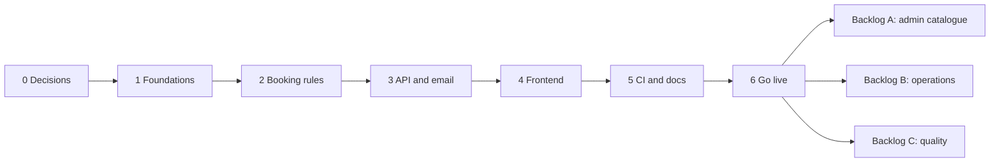

# ROADMAP — Implementation phases and tasks

**Status:** v1.0, 2026-11-25. The deadline is today [C], so the plan was compressed into one day. Phases 0–5 are **done** in this repository; phase 6 needs your accounts; the backlog follows.

## 1. Today (2026-11-25)

| Phase            | Tasks                                                                                                                                                                             | Deliverable                       | Completion criteria                                                                      | Status                     |
| ---------------- | --------------------------------------------------------------------------------------------------------------------------------------------------------------------------------- | --------------------------------- | ---------------------------------------------------------------------------------------- | -------------------------- |
| 0. Decisions     | Close open questions; switch to Netlify + Nodemailer; cut scope                                                                                                                   | Docs v1.0                         | All decisions recorded in `PRD.md` section 9                                             | Done                       |
| 1. Foundations   | Project setup, tooling (TS strict, ESLint, Prettier, Vitest, Playwright), SQL schema with exclusion constraint, migration runner, seed                                            | `db/`, configs                    | Migrations apply on an empty database                                                    | Done                       |
| 2. Booking rules | Slot engine, start checks, cancellation rule, stylist choice; unit tests incl. DST and property test                                                                              | `src/server/domain`               | 100 % line coverage on domain; DST tests pass                                            | Done                       |
| 3. API and email | Router, availability, bookings with savepoint retry, private link, contact, admin auth and screens' API, rate limits, Nodemailer, French templates, scheduled reminders and purge | `src/server`, `netlify/functions` | 28 integration tests on PostgreSQL pass, incl. 25-round concurrency test                 | Done                       |
| 4. Frontend      | Rebuild the demo in React: home, services, team, gallery, info, contact, booking flow, manage page, legal pages, admin (agenda, days off, closures)                               | `src/web`                         | E2E booking + cancel passes on desktop and mobile; axe: no critical or serious violation | Done                       |
| 5. CI and docs   | `ci.yml`, `staging.yml`, `release.yml`, Dependabot, PR template; dependency upgrades after audit; five documents and README                                                       | `.github/`, `docs/`               | Lint, types, audit (0 vulnerabilities), 60 + 8 tests green locally                       | Done                       |
| 6. Go live       | Accounts, secrets, first release (`DEVOPS.md` section 4)                                                                                                                          | Live URL                          | `/api/readyz` OK in production; one real booking with email received                     | **Your action** (≈ 20 min) |

### Risks for today

| Risk                                                       | Mitigation                                                                                                                                                                       |
| ---------------------------------------------------------- | -------------------------------------------------------------------------------------------------------------------------------------------------------------------------------- |
| Gmail refuses login                                        | App password requires 2-Step Verification; set `MAIL_MODE=log` to demo without email (the confirmation page still shows the private link).                                       |
| Netlify routes `/api/*` to the SPA instead of the function | No catch-all `/*` rule: `netlify.toml` rewrites only the five app pages to `index.html`. A new page needs its own line there. Check `/api/healthz` right after the first deploy. |
| `pg` or `nodemailer` bundling issues                       | Declared in `external_node_modules` in `netlify.toml`.                                                                                                                           |
| Running out of Netlify credits                             | Production deploys only on tags.                                                                                                                                                 |
| CI first run fails on GitHub (environment differences)     | Everything passed locally with the same commands; fix forward with a `fix(ci)` PR.                                                                                               |

## 2. Dependencies

## 3. Backlog (after submission)

| ID  | Item                                                                | Covers       | Effort   |
| --- | ------------------------------------------------------------------- | ------------ | -------- |
| A1  | Admin: create, edit, deactivate services                            | FR-12, AC-09 | 1 day    |
| A2  | Admin: edit stylists' services and weekly hours                     | FR-13        | 1 day    |
| A3  | Admin: manual booking (phone / walk-in)                             | FR-15        | 0.5 day  |
| A4  | Admin: mark completed / no-show                                     | FR-17        | 0.25 day |
| B1  | Nightly encrypted `pg_dump` (GitHub Actions, `age`) + restore drill | AC-13        | 0.5 day  |
| B2  | Uptime monitor and Sentry with PII scrubbing                        | Monitoring   | 0.25 day |
| B3  | "Next free slot" on the home page                                   | Demo parity  | 0.25 day |
| C1  | Lighthouse CI budgets                                               | NFR-03       | 0.25 day |
| C2  | k6 load test on availability                                        | NFR-02       | 0.25 day |
| C3  | Schemathesis fuzzing, OWASP ZAP baseline                            | NFR-09       | 0.5 day  |
| C4  | Frontend component tests (Vitest + Testing Library)                 | Quality      | 0.5 day  |
| C5  | Firefox and WebKit in a nightly E2E run                             | NFR-13       | 0.25 day |

## 4. Definition of done (every task)

- Merged through a PR with all required checks green.
- Tests for the new behaviour; domain coverage ≥ 90 %.
- No secret, no personal data in logs.
- French UI text, checked at 360 px and with the keyboard.
- Docs updated when behaviour, API or operations change.
